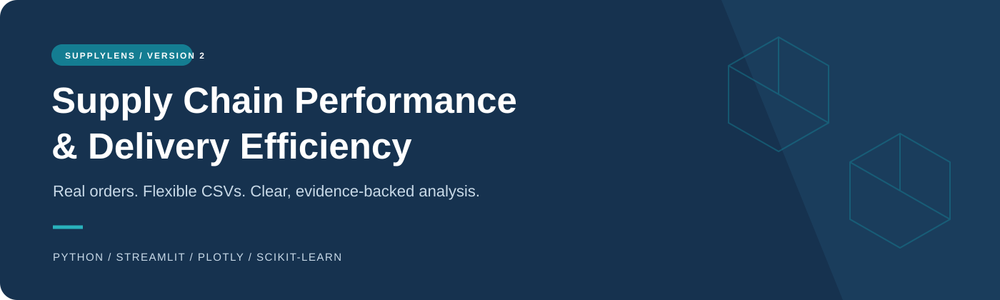
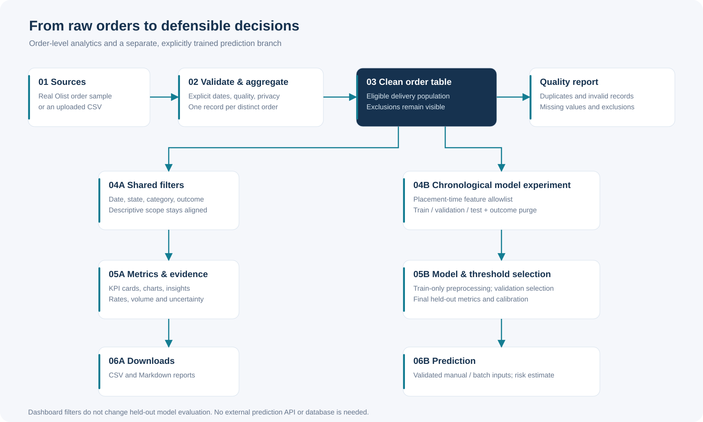

<p align="center">
  
</p>

<p align="center">
  <strong>Measure delivery honestly. Investigate with evidence. Predict with context.</strong>
</p>

<p align="center">
  
  
  
  <a href="https://github.com/Alex-7605/DSC_LJIET_21/actions"></a>
  
  
</p>

<p align="center">
  <a href="#quick-start">Run locally</a> ·
  <a href="#what-you-can-explore">Features</a> ·
  <a href="#data-flow">Data flow</a> ·
  <a href="docs/RESULTS.md">Measured results</a> ·
  <a href="docs/VIVA_GUIDE.md">Viva guide</a>
</p>

# Supply Chain Performance and Delivery Efficiency Analysis

**SupplyLens · Version 2.0 — examination edition**

A redesigned local dashboard with a universal CSV exploration workspace, 200 MB uploads, printable reports and a double-click launcher. [What changed](CHANGELOG.md) · [CSV workspace guide](docs/CSV_WORKSPACE.md)

**Launch the installed project:** double-click **Start Project.cmd**. It opens a free local port automatically. The standard Streamlit command below remains supported.

A complete, beginner-friendly college data science project built with Python and Streamlit. It turns real e-commerce orders into consistent delivery metrics, interactive comparisons, numerical insights, and a leakage-aware late-delivery classification experiment.

The supply-chain branch measures **actual customer arrival against the delivery promise shown at checkout**. It keeps the excluded population visible and explains uncertainty alongside recommendations.

## What you can explore

| Page | What it answers |
|---|---|
| Overview | How many eligible orders arrived on time, and how long did delivery take? |
| Explore Data | Which records are usable, duplicated, invalid or missing outcomes? |
| Delivery Performance | Where are delays concentrated by rate, volume, severity and order month? |
| Business Insights | Which sufficiently large groups deserve investigation first? |
| Predict Delivery Risk | What risk does the selected model estimate from order-placement inputs? |
| Model Evaluation | How do three models compare on a fixed future holdout? |

Also includes CSV uploads with explicit mapping, consistent filters, Wilson intervals, batch inference, downloads with provenance, model fingerprints, a hand-checkable fixture and college presentation guides.

## Quick start

Tested runtime: **CPython 3.14 on Windows**. Direct dependencies are pinned in requirements.txt. An exact installed environment is recorded in requirements-lock.txt.

### Windows PowerShell

Open PowerShell in the project folder:

```powershell
cd C:\Users\infoa\Personal\DSC_LJIET_21
py -3.14 -m venv .venv
.\.venv\Scripts\python.exe -m pip install -r requirements.txt
.\.venv\Scripts\python.exe -m streamlit run app.py
```

Open the local address printed by Streamlit, usually http://127.0.0.1:8501.

No environment activation or PowerShell policy changes are needed. After activating your own environment, the requested launch command also works:

```text
streamlit run app.py
```

The included real sample loads immediately. On a fresh clone, open Model Evaluation and click **Train and evaluate models** once to create a session model. To generate the trusted local sample model and reproducible reports:

```powershell
.\.venv\Scripts\python.exe scripts\train.py
.\.venv\Scripts\python.exe -m pytest -q
```

Linux/macOS: create the environment with python3.14 -m venv .venv and use .venv/bin/python in the same commands.

## Dataset and scope

**Source:** [Brazilian E-Commerce Public Dataset by Olist](https://www.kaggle.com/datasets/olistbr/brazilian-ecommerce), published by Olist; accessed **1 November 2026**. The repository includes an adapted real 12,000-order sample. It is **not synthetic**.

The source license is **CC BY-NC-SA 4.0**. Preserve attribution, non-commercial use and share-alike terms for the data and adaptations. The application code has a separate MIT license. See [NOTICE](NOTICE.md), [sample license](data/sample/LICENSE.md), and [provenance with hashes](data/sample/provenance.json).

Item prices are summed **before** joining to orders. Categories use the provided English translation; multiple categories become Mixed. Customer linkage, names, fine locations and review text are absent. Order hashes are replaced with local identifiers.

The dataset supports actual customer delivery, promise dates, destination states, product categories, goods values and item counts. It does **not** supply shipping mode, discount, profit, customer segment, carrier reliability, inventory efficiency or measured savings in this sample. These measures are never invented. Currency is left as source monetary units.

The historical sample covers 2016–2018 and cannot establish current operations. Outcomes missing because an order was cancelled or undelivered are not automatically considered late.

To rebuild the sample, follow [official download instructions](data/raw/README.md), then run:

```powershell
.\.venv\Scripts\python.exe scripts\prepare_data.py --archive data\raw\olist.zip
.\.venv\Scripts\python.exe scripts\train.py
```

## Metric definitions

| Metric | Definition |
|---|---|
| Eligible delivered orders | Delivered/completed orders with valid actual and scheduled duration |
| Actual delivery duration | Customer-arrival calendar date − order-placement calendar date |
| Scheduled duration | Checkout promise calendar date − order-placement calendar date |
| Delay days | Actual − scheduled duration |
| On-time / late | Delay <= 0 / delay > 0 |
| On-time rate | On-time eligible orders / all eligible delivered orders |
| Mean signed delay | Early, on-time and late eligible orders combined |
| Mean late-only delay | Positive delay days among late orders only |

Arrival on the promised calendar day is on time. Cancelled, undelivered and unknown outcomes remain excluded from the rate denominator. Zero denominators display Not available. Sales sum order goods values once each and exclude freight; negative profit is allowed only where a supplied profit field supports it.

## Modeling with an honest baseline

Prediction moment: **order placement**, conditional on eventual observed delivery. Features are a strict allowlist of checkout-time attributes. Actual delivery, delay, final status and identifiers are excluded.

- Compare DummyClassifier, Logistic Regression and a modest Random Forest.
- Split by chronological order dates, keeping each order together.
- Purge earlier outcomes that would not have been known at the next cutoff.
- Fit imputation, scaling and one-hot encoding on training data only.
- Select the model and threshold using validation data.
- Evaluate the final test period once; report precision, recall, F1, ROC-AUC, AP, accuracy, confusion matrix and Brier score.
- Show reliability bins and explain coefficients as associations.

Dashboard filters do not alter the fixed holdout. Training requires sufficient dates, both classes and explicit placement-time availability confirmation. Supplied target disagreements block training. Risk estimates are not guaranteed confidence or causal predictions.

See [measured results](docs/RESULTS.md), [feature and split methodology](docs/METHODOLOGY.md), and [machine-readable evaluation](artifacts/model_evaluation.json).

## Bring your own data

Choose Upload CSV. General data exploration works with any valid supported table within the limits: inspect types/missingness, search and filter, build charts, and export selected rows with a manifest. To activate delivery metrics, choose Delivery analytics, confirm mappings and date format, specify order/item and financial grain, then validate. See the [CSV workspace guide](docs/CSV_WORKSPACE.md).

Required for delivery analytics: order ID, placement date, status, and either actual customer delivery plus promised date or explicitly verified order-to-customer-delivery durations. Explicit opt-in can generate row IDs for one-row-per-order data or derive delivered/unknown status from customer-arrival dates. Item uploads also require item_id. A shipment or carrier-handover timestamp is never an arrival-date substitute.

The configurable limit defaults to **200 MB**, **1,000,000 rows** and **300 columns**. CSV, TSV and delimited TXT support common separators, encodings, headerless files and optional header repair. The uploader receives SC_UPLOAD_LIMIT_MB explicitly; SC_MAX_ROWS and SC_MAX_COLUMNS configure table limits. Batch predictions are capped at 10,000 rows; local model training is limited to 100,000 eligible orders.

Unseen prediction categories are handled safely with a warning. Missing mandatory inference values, invalid numeric ranges and stale artifacts are rejected or ignored with an explanation. The app never accepts uploaded pickle/joblib files.

Uploads stay in local session memory; unknown columns are removed before analytical preview/export. Map only appropriate non-identifying business fields. Local source data is preserved, and no public app deployment is created.

## Presentation and downloads

The website uses a simple six-page layout. **Reset all filters** restores the full population; **Find order ID** applies to descriptive metrics and reports. Study materials remain separate in docs/.

**Downloads** prepares downloads on demand. Delivery exports include cleaned CSV, summary CSV, Markdown insights and a printable HTML report. Analytical CSV report context is stored on its first data row. General CSV exports bundle selected rows, a column profile and a source/filter manifest in a ZIP.

Both example files in data/examples/ are explicitly synthetic learning templates, separate from the included real Olist sample.

## Data flow



[Level 0, Level 1, model lifecycle and module explanations](docs/DATA_FLOW.md) include editable Mermaid diagrams that render directly on GitHub.

## Project layout

```text
DSC_LJIET_21/
├── app.py                     # Seven-page Streamlit application
├── src/
│   ├── data_loader.py         # Safe CSV input and mappings
│   ├── validation.py          # Quality, order grain and eligibility
│   ├── preprocessing.py       # Consistent descriptive filters
│   ├── metrics.py             # Shared delivery metric definitions
│   ├── insights.py            # Evidence-backed investigation priorities
│   ├── visualizations.py      # Plotly charts
│   ├── modeling.py            # Temporal training and predictions
│   └── reporting.py           # Provenance-aware safe exports
├── data/sample/               # Real privacy-reduced sample + license
├── scripts/                   # Rebuild sample; explicitly train
├── artifacts/                 # Measured evaluation and reports
├── tests/                     # Hand-checked metrics and workflow checks
├── docs/                      # Methodology, diagrams and college guides
├── .github/                   # Test workflow and issue template
└── requirements.txt
```

## Documentation map

| Document | Purpose |
|---|---|
| [Data dictionary](docs/DATA_DICTIONARY.md) | Columns, units, source mappings and missing handling |
| [Methodology](docs/METHODOLOGY.md) | Eligibility, aggregation, leakage prevention and temporal experiment |
| [Data flow](docs/DATA_FLOW.md) | Context, detailed flow and model lifecycle |
| [Results](docs/RESULTS.md) | Actual metrics, split dates and limitations |
| [CSV workspace](docs/CSV_WORKSPACE.md) | Formats, limits, inference, mappings and general charts |
| [Verification](docs/VERIFICATION.md) | Executed tests and manual checks |
| [Viva guide](docs/VIVA_GUIDE.md) | Introduction and 22 likely questions |
| [Demo script](docs/DEMO_SCRIPT.md) | Five-minute presentation |
| [Contributing](CONTRIBUTING.md) | How to make a reproducible change |

## Troubleshooting

| Problem | Action |
|---|---|
| streamlit command not found | Use .venv\Scripts\python.exe -m streamlit run app.py |
| PowerShell blocks activation | Use the explicit environment Python path; activation is optional |
| Port 8501 is occupied | Add --server.port 8502 |
| No model appears | Train explicitly; changed data invalidates old models |
| CSV dates disappear | Confirm the explicit date format and inspect exclusion reasons |
| Repeated order IDs are conflicts | Choose item grain only for genuine line items and map item_id |
| Encoding error | Select the file's actual encoding; the app does not silently guess |
| Not enough model data | Keep descriptive analysis; obtain more dates and both outcomes |
| Windows blocks a library DLL | Use a supported official Python environment or contact the device administrator; do not disable security protections |
| A pinned dependency has no wheel | Use Python 3.14 and a current pip version |

## Interpretation limits

The sample is historical, geographically specific and observational. Conditional delivery risk excludes cancellation/non-delivery risk. Actual label reporting latency is unavailable. Minimum group size and Wilson intervals reduce overconfidence but do not prove significance. Priority weights and F1 thresholds are heuristics; no intervention, causal benefit or savings has been measured.
