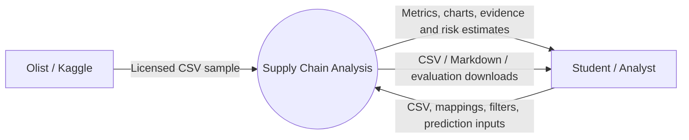
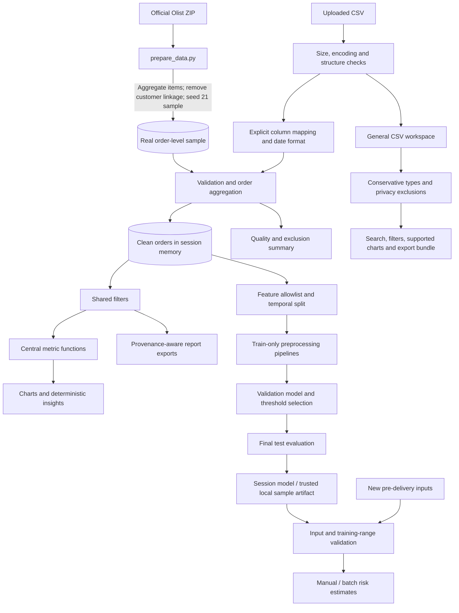
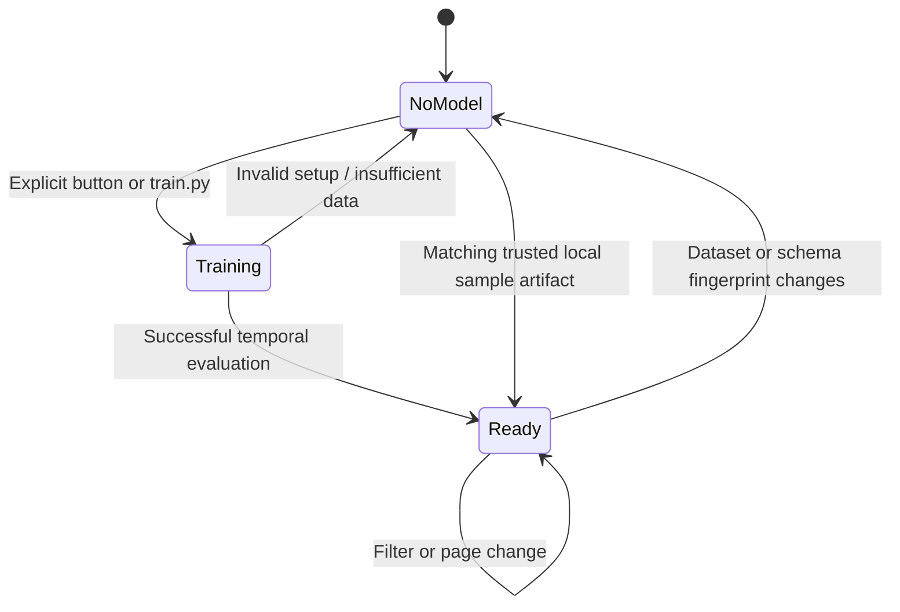

# Data flow and system design

The external entities are the student/analyst and the official Olist source. Data stores are local CSV files, session memory, and explicitly generated trusted model files. No database or external inference service is required.

## Level 0 — context diagram

## Level 1 — analytical data flow

Dashboard filters affect descriptive analysis and its downloads. The model branch deliberately uses the full validated dataset and a fixed chronological holdout.

## Model lifecycle

## Modules

| Module | Responsibility |
|---|---|
| app.py | Local Streamlit navigation, forms, state and page layout |
| data_loader.py | Bounded CSV input, unambiguous alias suggestions, field allowlist |
| validation.py | Explicit dates, quality checks, item-to-order aggregation, eligibility |
| preprocessing.py | Shared descriptive filters |
| metrics.py | KPI definitions, grouped statistics and Wilson intervals |
| insights.py | Evidence-backed findings and heuristic investigation ranking |
| visualizations.py | Plotly charts with shared visual styling |
| modeling.py | Feature audit, purged chronological splits, pipelines and predictions |
| reporting.py | Consistent provenance-aware downloads and formula-safe CSVs |

See [the static diagram](assets/data-flow.svg) for a portable rendering.
## Version 2 route selection

General CSV exploration does not require order fields. Only an explicit delivery mapping enters the order-validation/model branch. Both routes preserve source bytes, bound file/table size and keep user uploads in session memory. Delimiter, encoding, header and numeric-format choices appear in the import workflow.

The general route uses source-row grain and separate provenance-aware ZIP exports. The delivery route retains its eligible-order metric definitions and fixed temporal model evaluation. Neither route silently turns an arbitrary numeric column into a late-delivery target.